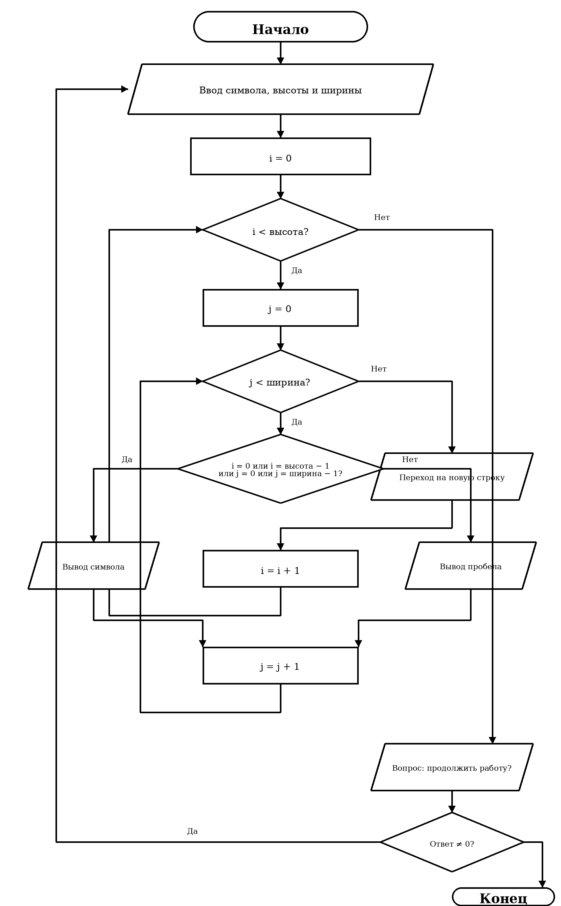

# Домашка к 9 лабе
### Вариант 4
Цель работы — разработать программу на языке C, которая выводит на экран пустой прямоугольник из заданного пользователем символа. Предусмотреть возможность изменения высоты и ширины фигуры, используя циклы и условные операторы.

Вывод: В ходе выполнения задания была разработана программа на языке C для построения пустого прямоугольника с помощью заданного символа. Были использованы вложенные циклы for для формирования строк и столбцов, а также условные операторы для отображения границ фигуры. В результате были закреплены навыки работы с циклами, условиями и форматированием вывода на экран.